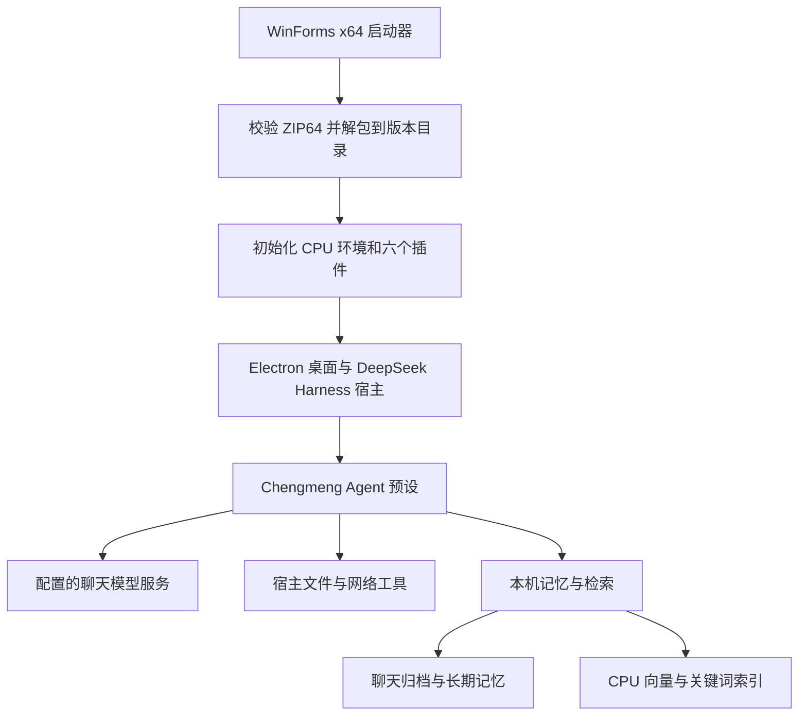

# 橙萌 Chengmeng

**为有过监禁经历的跨性别者设计的生活支持助手。你可以从今天最想处理的一件事开始。**

离开监所后，住处、证件、工作和日常开销，可能同时摆在面前。有时你想先改好一份简历，有时只是想把心里乱糟糟的事说一说。如果上次已经理出了一点头绪，也可以接着聊。

橙萌是基于 [DeepSeek Harness](https://github.com/deepseek-ai/deepseek-harness) 的开源 Windows 桌面助手。它把五个生活支持 Skill、聊天归档、长期记忆和本地语义检索放进同一个桌面应用。它会沿用你给出的称呼。你可以直接说想做什么，由你决定先处理哪件事、哪些经历愿意谈。

[下载 Windows x64 安装包](https://github.com/zararogers338-hash/chengmeng/releases/download/v0.5.0/Chengmeng-0.5.0-Windows-x64.exe) · [发行说明与校验文件](https://github.com/zararogers338-hash/chengmeng/releases/tag/v0.5.0) · [使用指南](docs/USAGE.md) · [架构说明](docs/ARCHITECTURE.md)

**阅读导航** · [可以用它做什么](#可以用它做什么) · [安装和首次使用](#安装和首次使用) · [模型与 API 配置](#模型与-api-配置) · [技术架构](#技术架构) · [数据与隐私](#数据与隐私) · [从源码构建](#从源码构建) · [隔离验收与排障](#隔离验收与排障)

## 可以用它做什么

> “今天先帮我改简历。我想把做过的工作写清楚。”
>
> “我们上周聊过租房预算。帮我找一下，再列几条看房时要问的问题。”

| 内置 Skill | 可以一起做的事 |
| --- | --- |
| 日常生活支持 | 安排这周的日程、改简历、比较住处，或把收入和支出列成一张表。 |
| 社会资源导航 | 把证件、住房、就业和支持资源的问题拆开，列出已有材料、待确认事项和下一步，也可以拟一段发给机构的咨询文字。 |
| 情绪与压力支持 | 按你希望的方式聊聊近况。可以先说一说发生了什么，也可以一起想一个眼下做得到的下一步。 |
| 性别与健康资源导航 | 在你主动提出需要时，梳理相关资料，准备想向专业人员询问的问题，区分一般信息与当地服务条件。 |
| 紧急支持导航 | 在明确的即时危险情境中，帮你厘清可以联系的现实支持和当地紧急服务。实际联络由你或身边的人发起。 |

内置资料标注来源、地区范围和核验日期。当地政策、资格与服务是否开放需要另行核实。健康与紧急支持 Skill 提供资料导航和咨询准备，诊断、治疗与现场处置由相应专业人员负责。

## 安装和首次使用

| 项目 | v0.5.0 要求 |
| --- | --- |
| 系统 | Windows 10/11 x64 |
| 安装包 | `Chengmeng-0.5.0-Windows-x64.exe`，约 1.79 GB |
| 磁盘 | 建议预留至少 8 GB 可用空间 |
| 本地检索 | 安装包已包含 CPU 向量模型和运行依赖。启动向量模型前默认检查 4 GB 可用内存，资源不足时退回关键词检索。 |
| 聊天 | 使用自己的模型账号或 API Key。在线模型需要网络，额度由账号或服务提供。 |

直接下载并双击安装包即可。第一次运行会自动解包和初始化，可能需要几分钟。后续可从桌面或开始菜单快捷方式打开。日常使用无需另装 DeepSeek Harness、Node.js、Python 或 GPU。

也可以在有足够磁盘空间的目录中打开 **PowerShell**，运行以下命令下载、校验并启动公开发行包：

```powershell
$ErrorActionPreference = 'Stop'
$installer = Join-Path (Get-Location).Path 'Chengmeng-0.5.0-Windows-x64.exe'
$release = 'https://github.com/zararogers338-hash/chengmeng/releases/download/v0.5.0'
$expected = '21de3156ab172c06c4df112682acfbbfd2d6401391be7a0a721d7e9aff756acc'

if (-not (Test-Path -LiteralPath $installer -PathType Leaf)) {
    $partial = "$installer.part"
    Invoke-WebRequest -UseBasicParsing -Uri "$release/Chengmeng-0.5.0-Windows-x64.exe" -OutFile $partial
    if ((Get-FileHash -LiteralPath $partial -Algorithm SHA256).Hash -ne $expected) {
        throw '下载文件的 SHA-256 与发行记录不一致，请重新下载。'
    }
    Move-Item -LiteralPath $partial -Destination $installer
}

if ((Get-FileHash -LiteralPath $installer -Algorithm SHA256).Hash -ne $expected) {
    throw '当前目录中的安装包校验失败，请移走该文件后重新下载。'
}
Start-Process -FilePath $installer
```

启动器未使用商业代码签名证书。上面的 SHA-256 用于核对文件是否与 GitHub Release 公布的版本一致。

1. 打开应用，登录自己的模型账号或填写 API Key。
2. 新建会话，使用预设 **Chengmeng**。这是 v0.5.0 安装包里的界面名称。
3. 第一次聊到个人经历前，可以先看一眼记忆设置。聊天归档与长期记忆在新安装中默认开启，分别管理。

## 模型与 API 配置

在 **设置 → 模型** 中选择接入方式。橙萌沿用固定版本 DeepSeek Harness `0.2.2-rc.1` 的模型配置和模型选择器。

| 接入方式 | 需要配置 |
| --- | --- |
| DeepSeek | 登录自己的 DeepSeek 账号，或在模型设置的 DeepSeek 卡片填写 API Key。 |
| 第三方模型 | 在「添加模型提供商」里选择上游目录中的提供商，填写相应凭据。该版本上游文档列出的例子包括 OpenAI、Anthropic、Kimi 和 GLM。 |
| 自定义模型 API | 填写 Provider ID、基础 URL、API 协议、凭据和至少一个模型 ID。上游提供 OpenAI Chat Completions、OpenAI Responses、Anthropic Messages 三种协议。 |

保存后，在会话的模型选择器选中对应模型。端点协议、模型能力和工具调用支持由所选服务决定，项目的公开验收记录未逐一覆盖这些提供商。详见[同版本的上游模型配置指南](https://github.com/deepseek-ai/deepseek-harness/blob/dsh-v0.2.2-rc.1/docs/user/guide/providers.zh.md)。

## 技术架构



`desktop/Launcher.cs` 校验自解包 EXE 的 ZIP64 载荷与 SHA-256，先写入临时目录，再标记版本安装完成。`desktop/prepare.cjs` 通过随包的 Electron Node 模式初始化 Harness profile，并从随包 wheels 安装 Python 3.12 和 CPU PyTorch。`desktop/chengmeng-main.mjs` 设置独立桌面状态目录，再进入上游 Electron 主程序。同一数据目录的重复启动会聚焦已有窗口。

| 模块或目录 | 职责 |
| --- | --- |
| [`plugins/agent-core`](plugins/agent-core) | 注册 Chengmeng 预设、人格和回复风格，按宿主已注册能力应用工具策略。 |
| [`plugins/memory-consent`](plugins/memory-consent) | 聊天归档、长期记忆写入、检索、状态接口和记忆管理界面。目录名沿用早期设计，当前桌面发行默认自动保存。 |
| [`plugins/support-skills`](plugins/support-skills) | 五个生活场景 Skill，以及带来源、适用范围和核验日期的静态资料目录。 |
| [`plugins/pastel-theme`](plugins/pastel-theme) | Pastel 配色、玻璃输入框、思考强度控件和首页布局。 |
| [`plugins/startup-animation`](plugins/startup-animation) | 可跳过的启动动画，遵循系统减少动态效果偏好。 |
| [`plugins/appearance-settings`](plugins/appearance-settings) | 主题、玻璃效果和动画开关。 |
| [`desktop`](desktop) | Windows 启动器、Electron 入口、离线依赖初始化、构建和发布审计。 |
| [`scripts`](scripts)、[`tests`](tests) | 插件构建、数据备份恢复、单元和集成测试。 |

预设会按会话需要选择 Skill。文件读取与编辑、图片、PowerShell 和网页搜索或抓取沿用宿主工具，具体能力取决于实际注册的工具、访问模式和所选模型。

### 记忆的写入与召回

| 数据层 | 写入内容 | 读取方式 |
| --- | --- | --- |
| 聊天归档 | 使用过 Chengmeng 预设的会话文本，包括用户消息、助手回复和部分已读取资料的摘录，保留时间与来源。 | `recall_history` 按关键词、语义或时间范围检索。 |
| 整理后的长期记忆 | 助手从用户明确表达过的偏好、目标和事项中提炼条目。自动模式会核对原话，并标明来源。 | `recall_memory` 查找条目，`propose_memory` 提交整理内容，`memory_status` 查看保存开关、索引或降级状态。 |
| 派生索引 | BM25 关键词索引和本地向量索引，可从已保存数据重建。 | 通过倒数排名融合合并语义与关键词结果。向量不可用时退回关键词，时间回顾可独立查询。 |

桌面版启用 `qwen-hybrid`。Qwen3-Embedding-0.6B 由本机 CPU 工作进程按需加载，默认生成 **1024 维**向量，使用 **4 个线程**，空闲 **120 秒**后回收进程。Node.js 和 Python 通过标准输入输出交换数据。管理界面复用宿主认证下的 `/chengmeng-memory` 路由，例如 `GET /status`、`POST /memory-query` 和 `POST /history-query`。这些是应用内部的记忆接口，聊天模型通过上游模型配置接入。

## 数据与隐私

**新安装默认自动保存聊天归档和长期记忆，两者均以明文保存在本机。** 可以分别关闭，也可以把长期记忆改为手动确认。整理后的条目可查看、修改、删除和导出为 Markdown 或 JSON。关闭归档后，已有归档和原始会话仍会保留。删除整理条目只作用于该条目，原始会话、聊天归档和已有备份分别管理。

本机运行记忆存储与向量计算。使用在线聊天模型时，消息、相关召回片段以及模型请求所用的工具上下文可能发送给你配置的服务。公开安装包从空白账号和记忆开始，发布审计检查凭据、聊天记录、记忆与个人文件是否混入发行物。

| 内容 | Windows 默认位置 |
| --- | --- |
| 程序版本 | `%LOCALAPPDATA%\Chengmeng\packages` |
| 用户数据根目录 `DSH_HOME` | `%LOCALAPPDATA%\Chengmeng\data` |
| 宿主会话与附件 | `<DSH_HOME>\sessions`、`<DSH_HOME>\attachments` |
| 整理后的长期记忆 | `<DSH_HOME>\chengmeng\memory\memory` |
| 聊天归档 | `<DSH_HOME>\chengmeng\memory\history-archive` |
| 启动日志 | `%LOCALAPPDATA%\Chengmeng\launcher.log`，指定安装根目录时位于该目录 |

### 更新、迁移与备份

更新前退出橙萌以及使用同一数据目录的其他 Harness 实例，再运行新版完整 EXE。版本文件与数据目录分离。迁移时用 `--data-home` 指向现有 **DSH_HOME 根目录**。程序通过新的橙萌发行包更新。

备份脚本在源码仓库中，使用 Node.js 运行。先关闭正在使用该目录的应用。备份目标必须是源目录以外的一个新路径，恢复目标必须为空或尚未创建。

```powershell
$sourceHome = Join-Path $env:LOCALAPPDATA 'Chengmeng\data'
$backup = 'D:\ChengmengBackup'
$restoredHome = 'D:\ChengmengRestored'

node .\scripts\data-backup.mjs backup --home $sourceHome --destination $backup
if ($LASTEXITCODE -ne 0) { throw '备份失败。' }

# 仅在需要恢复时执行后面的命令。
node .\scripts\data-backup.mjs restore --backup $backup --home $restoredHome
if ($LASTEXITCODE -ne 0) { throw '恢复失败。' }

# 此处假设完整发行 EXE 已放在当前目录。
& .\Chengmeng-0.5.0-Windows-x64.exe --data-home $restoredHome
```

备份包含记忆、归档、待确认条目、记忆开关、宿主会话和附件，为明文。凭据、profile 设置、派生索引和外观偏好留在原环境。恢复时逐项校验 SHA-256，启动后需重新登录或配置 API Key，索引会在后续检索中重建。使用自定义记忆目录时，备份命令可加 `--memory-dir <绝对路径>`。

## 从源码构建

此路线用于构建自有 Windows EXE。准备 **Windows 10/11 x64、Git、Node.js 22.12 或更高版本、.NET Framework 4.x C# 编译器**，并先安装[官方 DeepSeek Harness 0.2.2-rc.1 Windows x64 运行时](https://download.deepseek.com/dsh-desk/bin/win-x64/deepseek-harness-0.2.2-rc.1-win-x64.exe)。仓库的 Windows CI 使用 Node.js 24。打包脚本会检查上游 ASAR 中的版本。已有对应版本的官方运行时目录也可以通过 `-VendorRoot` 指定。

从一个空目录打开 PowerShell 执行。首次构建需能访问 npm、PyPI、PyTorch CPU wheel 源和 Hugging Face。

```powershell
$ErrorActionPreference = 'Stop'
git clone --branch v0.5.0 https://github.com/zararogers338-hash/chengmeng.git
if ($LASTEXITCODE -ne 0) { throw '克隆失败。' }
Set-Location .\chengmeng

$vendorRoot = Join-Path $env:LOCALAPPDATA 'Programs\DeepSeek Harness'
$python = Join-Path $vendorRoot 'resources\runtime\primary-runtime\dependencies\python\python.exe'
if (-not (Test-Path -LiteralPath $python -PathType Leaf)) {
    throw '请先准备指定版本的官方桌面运行时，或调整 $vendorRoot。'
}

npm ci --prefix desktop --ignore-scripts
if ($LASTEXITCODE -ne 0) { throw '安装打包依赖失败。' }
& $python -I .\desktop\fetch-build-inputs.py
if ($LASTEXITCODE -ne 0) { throw '获取构建输入失败。' }
powershell.exe -NoProfile -ExecutionPolicy RemoteSigned -File .\desktop\build.ps1 -VendorRoot $vendorRoot
if ($LASTEXITCODE -ne 0) { throw 'Windows EXE 构建失败。' }
npm test
if ($LASTEXITCODE -ne 0) { throw '插件测试失败。' }
& $python -I .\desktop\package-source.py
if ($LASTEXITCODE -ne 0) { throw '源码打包失败。' }
& $python -I .\desktop\audit-release.py
if ($LASTEXITCODE -ne 0) { throw '发布审计失败。' }
```

如果在已有源码目录中构建，直接从设置 `$vendorRoot` 开始。`fetch-build-inputs.py` 按锁定版本获取 Windows x64 CPU wheels 和 Qwen 模型，并校验权重哈希。`build.ps1` 构建插件、准备 staging、编译启动器并生成 EXE。仅开发插件时，在仓库根目录运行 `npm run build` 和 `npm test` 即可，测试使用虚构资料。

| `dist/` 中的输出 | 用途 |
| --- | --- |
| `Chengmeng-0.5.0-Windows-x64.exe` 与 `.exe.sha256` | Windows 分发包与外部校验文件。 |
| `Chengmeng-0.5.0-source.zip` 与 `.zip.sha256` | 可审阅的源码、公开文档、测试夹具和对应校验文件。 |
| `public-release-audit.json` | 对实际 EXE 与源码包的完整性和发布内容审计。 |

本地重建产物请使用此次构建生成的校验文件。源码版的完整构建前提与发布边界见[桌面构建指南](desktop/BUILD.md)。

## 隔离验收与排障

### 验证本地安装与 CPU 推理

下面的命令从仓库根目录运行，使用刚构建的 EXE。安装目录与数据目录位于独立的临时路径，验收会初始化这些目录并跳过正常启动和快捷方式，然后用两条虚构文本检查 CPU 向量推理。

```powershell
$installer = (Resolve-Path .\dist\Chengmeng-0.5.0-Windows-x64.exe).Path
$smokeRoot = Join-Path $env:TEMP ('chengmeng-smoke-' + [guid]::NewGuid().ToString('N'))
$smokeInstall = Join-Path $smokeRoot 'install'
$smokeHome = Join-Path $smokeRoot 'data'
$smokeArgs = @(
    '--install-root', ('"{0}"' -f $smokeInstall),
    '--data-home', ('"{0}"' -f $smokeHome),
    '--isolated', '--prepare-only', '--no-shortcuts', '--quiet'
)
$process = Start-Process -FilePath $installer -ArgumentList $smokeArgs -Wait -PassThru
if ($process.ExitCode -ne 0) { throw "初始化失败。日志位于 $smokeInstall\launcher.log" }

$package = Get-ChildItem -Directory -LiteralPath (Join-Path $smokeInstall 'packages') |
    Where-Object { Test-Path -LiteralPath (Join-Path $_.FullName '.chengmeng-complete') } |
    Select-Object -First 1
if (-not $package) { throw '未找到初始化完成的版本目录。' }
node .\desktop\check-cpu.mjs $package.FullName
if ($LASTEXITCODE -ne 0) { throw 'CPU 向量推理验收失败。' }
```

| 启动参数 | 用途 |
| --- | --- |
| `--install-root <路径>` | 指定解包及安装目录。 |
| `--data-home <路径>` | 指定数据根目录，可用于迁移已有 DSH_HOME。 |
| `--prepare-only` | 完成解包和初始化后退出。 |
| `--isolated` | 跳过启动偏好读写及小启动器、快捷方式安装。隔离验收时同时指定独立的安装和数据路径。 |
| `--no-shortcuts` | 跳过创建快捷方式。 |
| `--quiet` | 隐藏准备窗口，运行详情写入启动日志。 |

### 常见情况

| 现象 | 检查方式 |
| --- | --- |
| 首次启动时间较长 | 确认磁盘空间足够。若初始化失败，在安装目录中查看 `launcher.log`。 |
| 提示登录或模型不可用 | 确认账号、API Key、模型 ID 与端点协议。联网模型由所选服务处理。 |
| 能按关键词查到，语义结果暂时不可用 | 检查 `memory_status` 中的索引和降级原因。向量模型可能仍在加载、构建索引，或遇到可用内存不足。 |
| 找不到过去聊过的内容 | 分别检查聊天归档和长期记忆开关、查询时间范围及当前数据目录。一次空结果只说明该次查询未命中。 |
| 提示数据目录正在使用 | 退出使用同一目录的旧桌面实例或网页宿主，再启动。 |

项目的 [v0.5.0 Windows 验证记录](docs/verification-v0.5.0.json) 记载了 290 项自动化测试、全新安装、带中文与空格的路径、重复启动、1024 维 CPU 推理和发布内容审计。当前公开发行的部署目标是 Windows x64。

## 参与开发与许可证

橙萌是基于 DeepSeek Harness 的独立整合发行版。自有代码采用 [MIT 许可证](LICENSE)。[DeepSeek Harness 及第三方许可证](desktop/licenses)随发行保留，Qwen3-Embedding-0.6B 权重采用 Apache-2.0。

[贡献指南](CONTRIBUTING.md) · [版本记录](CHANGELOG.md) · [提交问题](https://github.com/zararogers338-hash/chengmeng/issues)
