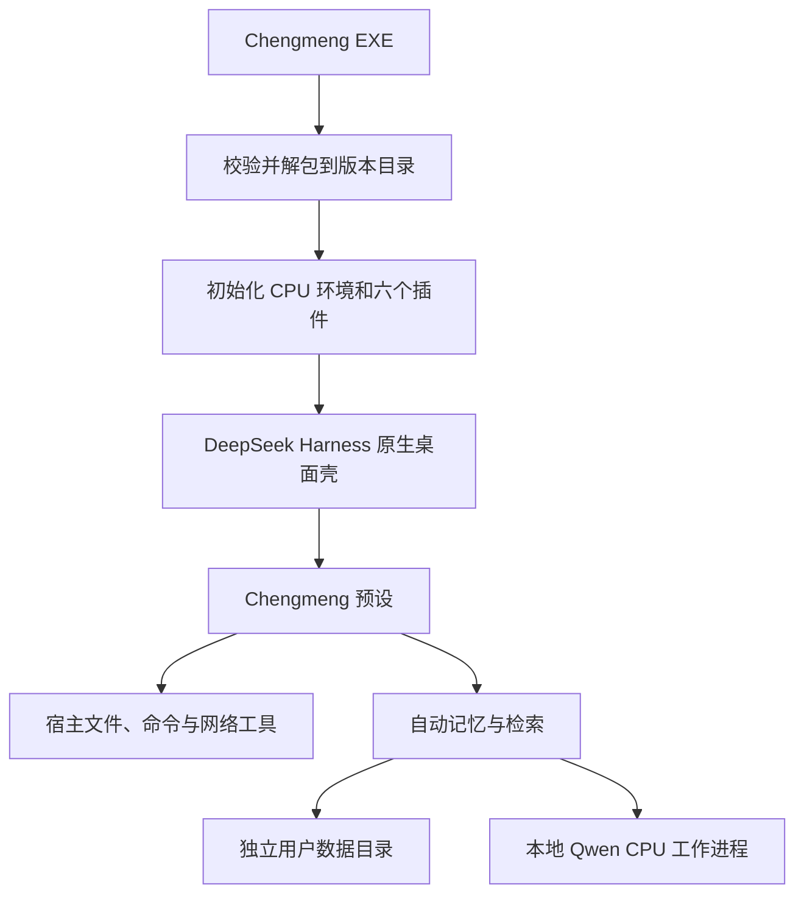

# 架构

## 桌面启动

`desktop/Launcher.cs` 是 WinForms x64 启动器。完整 EXE 末尾包含 ZIP64 载荷及 56 字节校验尾部。首次解包先验证 SHA-256，在临时版本目录中完成提取，再标记安装完成；不会把用户数据放入程序版本目录。

`desktop/prepare.cjs` 使用随包提供的 Electron Node 模式初始化本地 CPU Python 环境和保留的 desktop profile。配置更新只覆盖六个 Chengmeng 模块及带标记的集成配置，更新前保留 profile 元数据备份。

`desktop/chengmeng-main.mjs` 设置独立桌面状态目录和窗口标题，再进入上游桌面主程序。只有持有单实例锁的进程写入运行标记。重复打开交由原生单实例机制激活现有窗口。

## 六个模块

| 模块 | 职责 |
| --- | --- |
| agent-core | 原生 Agent/Persona 注册、提示词构建、按实际已注册能力开放工具 |
| memory-consent | 自动归档与整理记忆，管理设置、明文存储、查询和客户端面板 |
| pastel-theme | 主题 token、背景、玻璃输入框、思考强度控件、首页布局 |
| startup-animation | 可跳过的启动视觉，不阻塞宿主业务初始化 |
| support-skills | 五类通用资料及来源查询工具 |
| appearance-settings | 本地外观偏好的界面入口 |

`memory-consent` 是沿用的模块目录名；当前发行版默认采用自动记忆流程。

## 记忆数据与检索

完整聊天档案与整理记忆分别保存。检索可以按问题、时间范围与相关文本寻找资料。Qwen 编码器是懒启动的 CPU 工作进程，输入通过标准输入传递，输出归一化向量；索引属于可重建的派生数据。

向量和关键词后端组合工作。运行时或资源不足时允许关键词降级；状态工具应报告可用性和原因。旧敏感话题标签不用于隐藏可检索记忆。

数据和模型执行位置需要区分：记忆存储及嵌入计算在本机；模型回答可能使用在线服务，召回片段可以进入该服务的请求上下文。

## 源码与发行物

Git 仓库保存自有源码、公开文档和虚构测试夹具。运行时、模型权重和 wheels 留在本地构建缓存，并随 Windows Release 分发。

上游 ASAR 只对副本追加自定义入口和发行元数据，保留原始 dsh 数据段及 unpacked 标记，不修改已安装的官方程序。发行包保留上游及第三方许可证。

发布前使用 `desktop/audit-release.py` 检查实际 EXE、源码 ZIP 和文件白名单。用户账号、历史数据、上传目录及开发机缓存不属于发行内容。
